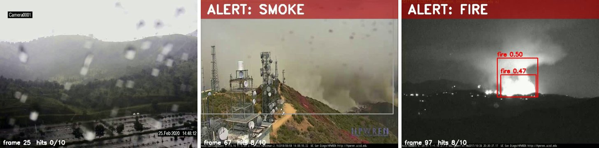
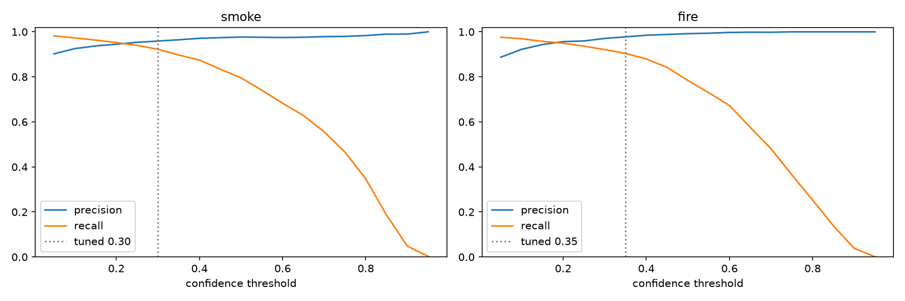

# Fire and Smoke Detection

**Real-time fire and smoke detection with YOLOv8n, trained on the [D-Fire dataset](https://github.com/gaiasd/DFireDataset).**

One notebook covers the whole pipeline: checking the dataset, training, testing, a video alert and a CPU
speed test. A Streamlit app runs the model on photos, uploaded videos and a live camera.



*An empty scene stays clear, while smoke and fire raise an alert once they show up in 5 of the last 10 frames.*

## How it works

1. **Train**: YOLOv8n (pretrained on COCO) is fine-tuned on D-Fire's two classes, smoke and fire.
2. **Test**: measure it on the 4,306-image test split.
3. **Tune**: pick confidence thresholds that keep at least 90% recall, because missing a fire is worse
   than a false alarm.
4. **Alert**: on video, the alert turns on only when fire or smoke appears in at least 5 of the last
   10 frames, so one reflection or sunset frame can't trigger it.

## Results

On all 4,306 test images (2,005 of them have no fire or smoke):

| Thresholds (smoke / fire) | Fire or smoke caught | False alarms on empty scenes |
|---|---|---|
| 0.50 / 0.50 (default) | 84.9% | 0.6% |
| **0.30 / 0.35 (tuned)** | **94.1%** | **2.1%** |

Box-level mAP50 is 0.759 (smoke 0.822, fire 0.695). Speed is about 3 ms per image on an RTX 4050 laptop
GPU, and about 30-70 ms on the CPU.



## Try the app

The trained model is included (`weights/best.pt`, 6 MB), so you don't need the dataset to try it.

```bash
python -m venv .venv
.venv\Scripts\activate
pip install -r requirements.txt
streamlit run app/app.py
```

- **Photo**: upload a photo or try a sample.
- **Video**: upload a video to get a list of alerts with their start and end times.
- **Live camera**: use the webcam (`0`) or an IP camera address (`rtsp://...`).

For GPU training, install PyTorch with CUDA first:
`pip install torch torchvision --index-url https://download.pytorch.org/whl/cu128`.

## Run the notebook

Download D-Fire, set `DATA` in the settings cell to its folder, then open
`notebooks/fire_smoke_detection.ipynb` and run the cells from top to bottom. Training is off by default
(set `TRAIN = True`; 50 epochs took about 2 hours on an RTX 4050). Outputs go to `runs/`.

## Project structure

```
notebooks/   the whole pipeline in one notebook
app/         Streamlit app and sample photos
weights/     the trained YOLOv8n model
docs/        images used in this README
```

## Limits

- Trained and tested on D-Fire only. Other cameras and indoor scenes are not measured yet.
- Fire is harder than smoke: small or distant flames are often missed in single frames.
- The test video is made of still images, and the live mode hasn't been tried on a real fire or CCTV.

## Credits

- **Dataset:** [D-Fire](https://github.com/gaiasd/DFireDataset) by de Venâncio, Lisboa and Barbosa
  (Neural Computing and Applications, 2022). The demo frames come from its test split.
- **Model:** [Ultralytics YOLOv8](https://github.com/ultralytics/ultralytics), AGPL-3.0.

The code is under the [MIT License](LICENSE). The dataset and Ultralytics keep their own licenses.
